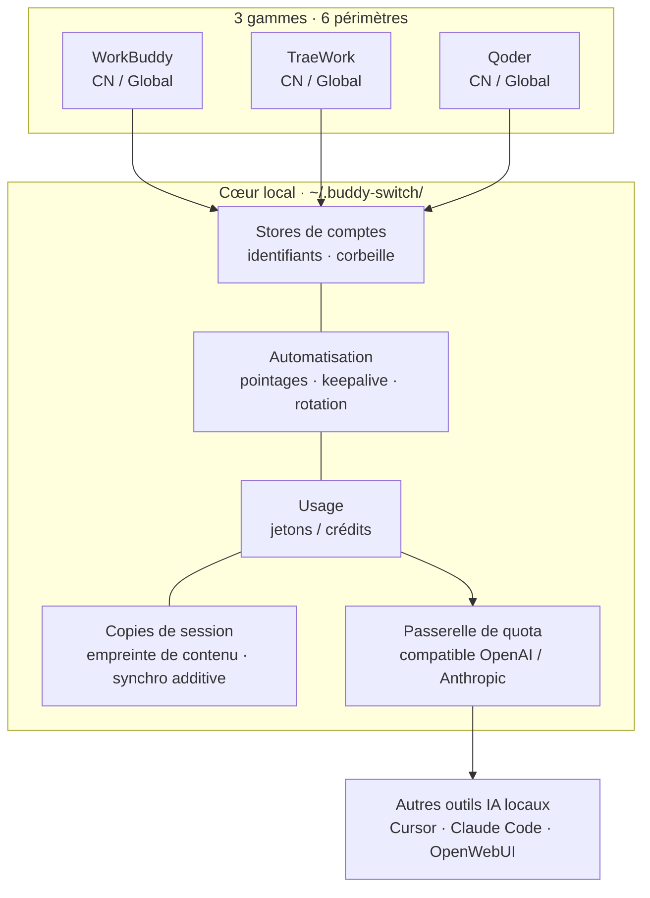
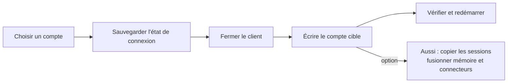
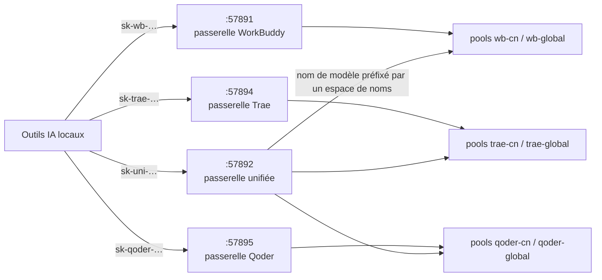
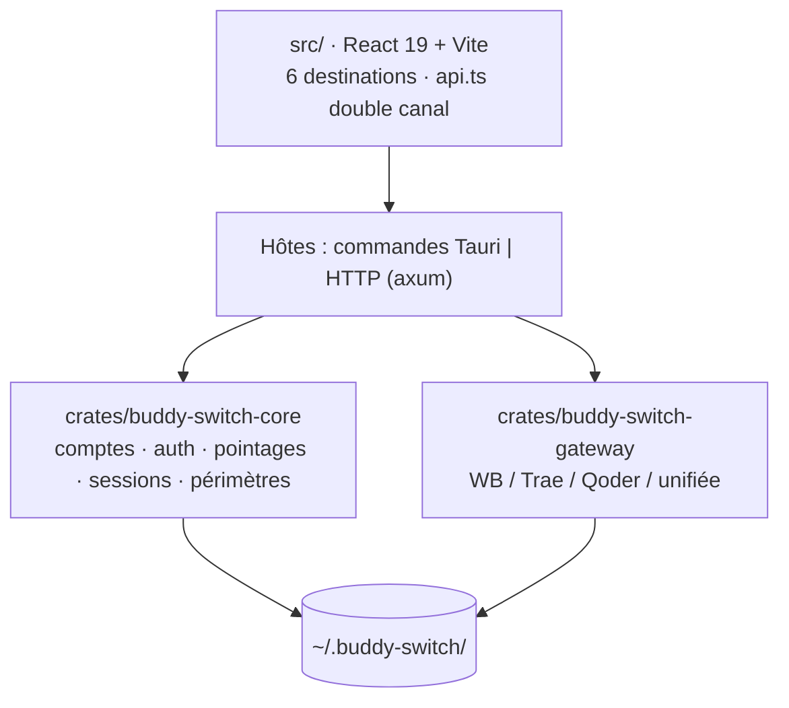

<p align="center">
  
</p>

<h1 align="center">Buddy Switch</h1>

<p align="center">
  <b>Poste de travail multi-comptes WorkBuddy · CodeBuddy · TraeWork · Qoder</b><br />
  « Sous quel compte suis-je connecté ? » — désormais un seul clic
</p>

<p align="center">
  
  <a href="https://github.com/NextAgentX/qoder-trae-workbuddy-switch/releases/latest"></a>
  <a href="./LICENSE"></a>
  <a href="https://github.com/NextAgentX/qoder-trae-workbuddy-switch/stargazers"></a>
</p>

<p align="center">
  <a href="README.cn.md">简体中文</a> ·
  <a href="README.md">English</a> ·
  <a href="README.ja.md">日本語</a> ·
  <a href="README.ko.md">한국어</a> ·
  <a href="README.ru.md">Русский</a> ·
  <strong>Français</strong> ·
  <a href="README.es.md">Español</a> ·
  <a href="README.pt.md">Português</a>
</p>

# Buddy Switch

Un poste de travail multi-comptes **100 % local** : il rassemble les comptes de quatre gammes — **WorkBuddy / CodeBuddy / TraeWork / Qoder** — et de **6 périmètres** au même endroit. Connexion par QR code ou code d'appareil, bascule de compte en un clic, pointages et crédits, analyse d'usage, synchronisation des copies de session — et exposition de votre quota de modèles aux autres outils IA locaux via des points d'entrée compatibles OpenAI / Anthropic.

|  |  |
| --- | --- |
| 🪪 **6 périmètres au même endroit** | Trois gammes × CN / Global, chacune avec son store de comptes. La bascule affiche sa progression et s'annule automatiquement en cas d'échec d'écriture. |
| ✅ **La liste des choses à faire se remplit seule** | La vue d'ensemble liste « reconnexion / pointage du jour / crédits qui expirent / client non lancé », avec l'action directement dans la ligne. |
| 📊 **Usage et limites visibles** | Jetons, crédits, limites « compte × modèle » et la copie de session qui retarde ou a divergé — sur un seul écran. |
| 🔌 **Le quota profite aussi aux autres outils** | Exposé en endpoint compatible OpenAI / Anthropic : Cursor, Claude Code, OpenWebUI. |

> **Nature et périmètre d'utilisation**
>
> Ce projet est le fruit d'un **usage personnel et d'un apprentissage** de son auteur : il a été écrit pour supprimer la corvée du changement de comptes. **Vous pouvez le lire, le forker et l'améliorer, mais aucune maintenance n'est promise** : pas de support commercial, pas de SLA, pas de garantie de compatibilité avec une version donnée du client.
>
> Licence **PolyForm Noncommercial 1.0.0** : **seul l'usage personnel non commercial est autorisé, tout usage commercial est interdit** (y compris les projets commerciaux internes à une entreprise, les services SaaS / hébergés, la revente et la distribution groupée). Tout usage commercial exige l'autorisation écrite préalable de l'auteur.

> ⚠️ **Non officiel · non commercial** : aucun lien d'affiliation, d'autorisation, de parrainage ou d'approbation avec WorkBuddy, CodeBuddy, TraeWork, Qoder ni leurs ayants droit ; **l'usage commercial n'est pas permis**. Il lit et écrit les données d'authentification des clients locaux, envoie des requêtes automatiques selon votre planification et peut relayer votre quota via un port local. Lisez l'**[avertissement](docs/policies/DISCLAIMER.en.md)** avant utilisation.

## Captures d'écran

<table>
  <thead>
    <tr><th>Vue d'ensemble (clair)</th><th>Vue d'ensemble (sombre)</th></tr>
  </thead>
  <tbody>
    <tr>
      <td></td>
      <td></td>
    </tr>
  </tbody>
</table>

<table>
  <thead>
    <tr><th>Comptes WorkBuddy (clair)</th><th>Comptes WorkBuddy (sombre)</th></tr>
  </thead>
  <tbody>
    <tr>
      <td></td>
      <td></td>
    </tr>
  </tbody>
</table>

<table>
  <thead>
    <tr><th>Usage · tendance (clair)</th><th>Usage · tendance (sombre)</th></tr>
  </thead>
  <tbody>
    <tr>
      <td></td>
      <td></td>
    </tr>
  </tbody>
</table>

<table>
  <thead>
    <tr><th>Passerelle (clair)</th><th>Passerelle (sombre)</th></tr>
  </thead>
  <tbody>
    <tr>
      <td></td>
      <td></td>
    </tr>
  </tbody>
</table>

<table>
  <thead>
    <tr><th>Passerelle Qoder (clair)</th><th>Passerelle Qoder (sombre)</th></tr>
  </thead>
  <tbody>
    <tr>
      <td></td>
      <td></td>
    </tr>
  </tbody>
</table>

<details>
<summary><b>Plus de captures (sessions / réglages / TraeWork / Qoder)</b></summary>

<table>
  <thead>
    <tr><th>Sessions (clair)</th><th>Sessions (sombre)</th></tr>
  </thead>
  <tbody>
    <tr>
      <td></td>
      <td></td>
    </tr>
  </tbody>
</table>

<table>
  <thead>
    <tr><th>Réglages (clair)</th><th>Réglages (sombre)</th></tr>
  </thead>
  <tbody>
    <tr>
      <td></td>
      <td></td>
    </tr>
  </tbody>
</table>

<table>
  <thead>
    <tr><th>Comptes TraeWork (clair)</th><th>Comptes TraeWork (sombre)</th></tr>
  </thead>
  <tbody>
    <tr>
      <td></td>
      <td></td>
    </tr>
  </tbody>
</table>

<table>
  <thead>
    <tr><th>Comptes Qoder (clair)</th><th>Comptes Qoder (sombre)</th></tr>
  </thead>
  <tbody>
    <tr>
      <td></td>
      <td></td>
    </tr>
  </tbody>
</table>

</details>

> Images générées par `scripts/gen-readme-shots.mjs` depuis la version démo (`VITE_DEMO_MODE=1`) ; comptes, crédits et requêtes sont fictifs. Après une refonte de l'interface, relancez simplement le script.

## Vue d'ensemble



**Trois règles intangibles** partout : les données restent sur cette machine, les identifiants ne sont écrits que dans l'état de connexion des clients (pas de connexion proxy, pas de modification des protocoles amont), et toute écriture est précédée d'une sauvegarde.

## Quatre formes

| Forme | Comment l'obtenir | Remarque |
| --- | --- | --- |
| **Application de bureau** | Télécharger l'installateur depuis [GitHub Releases](https://github.com/NextAgentX/qoder-trae-workbuddy-switch/releases/latest) | Empaquetée avec Tauri ; recommandée au quotidien |
| **webui** | Compiler depuis les sources (ci-dessous) | Même bundle frontal que l'application, servi en HTTP local |
| **Docker** | Récupérer l'image préconstruite `ghcr.io/nextagentx/buddy-switch` (amd64 / arm64) | Le conteneur embarque le **serveur headless** (webui + passerelles API), **pas** le commutateur de bureau ; voir [Déploiement Docker](docs/guides/DOCKER.md) |
| **Démo en ligne** | [GitHub Pages](https://nextagentx.github.io/qoder-trae-workbuddy-switch/) | Démo en lecture seule ; comptes et usage fictifs |

> Le paquet npm n'est pas encore publié : `npm i -g` ne l'installera pas. Pour la forme webui, utilisez la compilation depuis les sources ci-dessous.
>
> La forme Docker est **serveur uniquement** : changer la session du client, lancer le client, la zone de notification et la fenêtre flottante exigent un **client graphique sur la même machine** — rien de tout cela ne fonctionne dans le conteneur.

## Démarrage rapide

**Application de bureau** : téléchargez l'installateur de votre plateforme depuis Releases.

| Plateforme | Installateur | Installation |
| --- | --- | --- |
| macOS Apple Silicon (arm64) | `BuddySwitch_<version>_aarch64.dmg` | Ouvrir le DMG, glisser `BuddySwitch.app` dans Applications |
| macOS Intel (x86_64) | `BuddySwitch_<version>_x86_64.dmg` | Identique |
| Windows x64 | `BuddySwitch_<version>_x64-setup.exe` | Lancer l'installateur |
| Linux x64 | `BuddySwitch_<version>_amd64.deb` / `.AppImage` | Installer le `.deb`, ou rendre l'AppImage exécutable |

**webui (compilation depuis les sources)** : le bundle frontal est intégré au serveur **à la compilation** (`rust-embed`), l'ordre est donc impératif.

```bash
npm install
npm run build                                    # 1) frontend → dist/
cargo build --release -p buddy-switch-server     # 2) compiler le serveur (intègre dist/)
./target/release/buddy-switch                    # 3) lancer et ouvrir le navigateur (127.0.0.1:57890)
```

```bash
buddy-switch              # lancer le service + navigateur
buddy-switch serve        # service seul (--port pour le port)
buddy-switch status       # compte courant dans le terminal
buddy-switch version      # version
```

<details>
<summary><b>macOS : « développeur non vérifié » / « aucune autorisation » lors d'une bascule</b></summary>

- Développeur non vérifié : dans le Finder, clic droit (ou Control-clic) sur l'app → Ouvrir, ou Réglages Système → Confidentialité et sécurité → « Ouvrir quand même ».
- La bascule écrit le fichier d'authentification du client : accordez à BuddySwitch **Gestion des apps** (ou **Accès complet au disque**) dans Confidentialité et sécurité, puis relancez l'app. Le « contrôle des autorisations » des réglages permet de vérifier à tout moment.
- En forme webui, les autorisations sont celles du processus terminal qui a lancé le service.

</details>

## 6 périmètres (plateforme × région)

Le sélecteur en haut à gauche détermine l'ensemble de comptes géré. Le périmètre vit dans l'URL (`/s/wb-cn/accounts`) : rafraîchir, partager un lien, revenir en arrière conservent la position ; `⌘K` / `Ctrl+K` cherche tous périmètres confondus, `⌘1`–`⌘6` bascule directement.

| Périmètre | Plateforme | Région | Clients gérés |
| --- | --- | --- | --- |
| `wb-cn` | WorkBuddy | CN | WorkBuddy desktop, CodeBuddy CN IDE / CLI, extensions CodeBuddy pour VS Code / JetBrains |
| `wb-global` | WorkBuddy | Global | Mêmes clients (versions globales) |
| `trae-cn` | TraeWork | CN | Trae CN |
| `trae-global` | TraeWork | Global | Trae |
| `qoder-cn` | Qoder | CN | Qoder CN desktop / CLI |
| `qoder-global` | Qoder | Global | Qoder desktop / CLI |

Les six périmètres sont **totalement indépendants** : stores de comptes, clients, configuration et clés de passerelle séparés. Les deux anciennes lignes de programme Trae (TraeWork / TraeCode) ont été fusionnées en amont en un seul client ; les anciens identifiants ne servent qu'à la compatibilité.

## 6 destinations de la barre latérale

Identiques point par point sur les trois plateformes : **Vue d'ensemble · Comptes · Usage · Sessions · Passerelle · Réglages**. Les entrées sont filtrées par **capacité** (pas par branche de plateforme) : pas de capacité, pas d'entrée — et un accès direct par URL renvoie un état vide structuré.

| Destination | En une ligne |
| --- | --- |
| **Vue d'ensemble** | Ce qui demande une action (reconnexion / pointage du jour / crédits expirant / client non lancé) + cartes de statistiques + graphique des jetons sur 14 jours + aperçu des autres périmètres |
| **Comptes** | Vues cartes et tableau, emplacements de programme, connexion QR ou code d'appareil, import local, pointages, corbeille (30 jours), registre des limitations (WorkBuddy uniquement) |
| **Usage** | Un seul poste, quatre vues : tendance · modèles · sessions · crédits ; une barre de paramètres unique (période + source) |
| **Sessions** | Copies d'une même session entre comptes : qui est en retard, qui a divergé, vers qui synchroniser (**WorkBuddy uniquement**) |
| **Passerelle** | Passerelles indépendantes (une par périmètre) et passerelle unifiée (un seul fournisseur tous périmètres confondus) |
| **Réglages** | Neuf sections : général · compte et connexion · pointages et crédits · passerelle · planifications · client · autorisations et diagnostic · journaux · sauvegarde et restauration |

### Matrice des capacités

| Capacité | WorkBuddy | TraeWork | Qoder |
| --- | :---: | :---: | :---: |
| Store de comptes / connexion / import | ✅ QR + import | ✅ connexion web + JWT | ✅ code d'appareil + PAT |
| Emplacements de programme | ✅ 5 (4 commutables + 1 lecture seule) | ✅ 1 (client fusionné) | ✅ 2 (desktop / CLI) |
| Pointages / crédits | ✅ dont voyage auto et rotation auto | ✅ | ✅ pointage quotidien + offre / quota |
| Analyse d'usage | ✅ jetons + crédits | ✅ jetons + crédits | ⏳ source de données à brancher |
| Synchronisation des copies | ✅ empreinte de contenu + additive | — | — |
| Passerelle de quota | ✅ `:57891` | ✅ `:57894` | ✅ `:57895` |

## Comment se fait une bascule de compte



- **Sauvegarder avant d'écrire** : fichiers d'authentification, instantanés de connexion Trae et écrasements de session laissent toujours une copie de retour arrière.
- **Vérifier après écriture** : une écriture ratée est annulée automatiquement ; un client en cours d'exécution se voit refuser l'écriture, pour ne pas réécrire son état mémoire par-dessus le vôtre.
- **Suppression douce** : le compte part à la corbeille 30 jours et peut être restauré ; la suppression définitive emporte identifiants et instantanés.

## Passerelle de quota de modèles

Expose le quota du compte courant aux outils locaux : compatibilité OpenAI (`/v1/models`, `/v1/chat/completions`, `/v1/responses`) et Anthropic (`/v1/messages`), toutes deux en streaming SSE. Écoute en boucle locale par défaut.



- **Quatre écouteurs indépendants** : les ports forment un seul bloc **`5789x`** — `57890` interface · `57891` WorkBuddy · `57892` unifiée · `57893` hook de session · `57894` Trae · `57895` Qoder. Désactiver la passerelle unifiée n'affecte aucun client existant ; les routes `/v1/*` se recouvrent mot pour mot, donc elles **ne peuvent pas** être fusionnées dans un seul Router.
- **Les préfixes de clé sont une seule famille** : `sk-wb-` · `sk-trae-` · **`sk-qoder-`** · `sk-uni-` — le préfixe indique à lui seul quel port configurer.
- **Cycle de vie des clés** : révoquer · restaurer · supprimer (seules les clés révoquées sont supprimables). Le clair n'est renvoyé qu'à la création ; le store ne garde que sha256 et les 4 premiers/derniers caractères.
- **Quota et liste blanche par clé** : chaque clé peut plafonner sa consommation (plafond × période de remise à zéro — unité : tokens ou nombre de requêtes ; période : jamais / quotidienne / hebdomadaire / mois calendaire) et être restreinte à un ensemble de comptes (sélection par groupe entier). Au-delà du quota : 429 `quota_exceeded` ; si aucun compte autorisé n'est disponible : 401 `no_credential` (même code qu'un pool vide ; le `message` précise combien de comptes la liste blanche couvre et pourquoi ils sont indisponibles), **sans repli sur le pool complet**.
- **Pool de comptes** : sélection par solde et état de limitation, exclusion des comptes inutilisables, sondage des limites « compte × modèle », réactivation en un clic.

La **passerelle unifiée** résout le problème des modèles homonymes qui s'écrasent entre plateformes : le nom devient `<espace de noms>:<id du modèle>`, les espaces de noms dérivant du registre des périmètres (actuellement six : `wb-cn` / `wb-global` / `trae-cn` / `trae-global` / `qoder-cn` / `qoder-global`).

| Règle | Comportement |
| --- | --- |
| Nom de modèle sans préfixe | **400 systématique** avec la liste des préfixes valides (aucune valeur par défaut devinée, donc aucun basculement silencieux vers un mauvais pool) |
| Analyse de l'espace de noms | **Correspondance exacte du segment entier** (`trae` / `traework` / `traecode` sont préfixes l'un de l'autre) |
| Une clé, plusieurs plateformes | Une même clé `sk-uni-` peut autoriser plusieurs plateformes |
| `/v1/responses` sur `trae-*` | **501**, jamais de repli silencieux vers chat |
| État par défaut | **Désactivée** ; à activer dans la section « Passerelle unifiée » de la page Passerelle |

> Architecture : [UNIFIED-GATEWAY-ARCH.md](docs/specs/UNIFIED-GATEWAY-ARCH.md) · Extraits de configuration : [guides/GATEWAY-CLIENT-INTEGRATION.md](docs/guides/GATEWAY-CLIENT-INTEGRATION.md)

## Automatisation

Les planifications acceptent une heure **à la minute près** (ex. `09:37`), plusieurs horaires et un **décalage aléatoire** (±5/15/30 minutes) pour étaler les déclenchements.

| Côté | Tâches |
| --- | --- |
| WorkBuddy (6) | Pointage · voyage du chat · carte d'activité · keepalive du jeton · rentrée · oiseau de nuit |
| Trae (2) | Pointage · renouvellement automatique du JWT |

<details>
<summary><b>Politique de rotation automatique (WorkBuddy, anti-expiration des crédits)</b></summary>

Une boucle d'arrière-plan définit le compte par défaut des **prochains lancements de CodeBuddy CLI** sur le compte le plus urgent (expiration la plus proche avec des crédits restants). Ordre de décision :

1. Compte valide (requête OK, non expiré, crédits restants)
2. Urgence (si même le plus urgent dépasse `min_urgency_hours`, 72 h par défaut → pas de bascule)
3. Déjà la cible → pas de bascule
4. Délai de refroidissement (`cooldown_minutes`, 120 par défaut)
5. Protection d'activité (conversation dans les `active_guard_minutes` dernières, 30 par défaut → pas de bascule)
6. Filtre de valeur (crédits restants sous `min_remaining_credits` → pas la peine)
7. Anti-oscillation (écart inférieur à `min_gap_hours`, 24 par défaut → pas de bascule)

**Limite d'effet** : seul le compte par défaut des sessions futures change ; la session en cours n'est pas basculée à chaud — rechargez-la via ACP ou relancez le CLI.

</details>

<details>
<summary><b>Capacités applicatives (communes aux six périmètres)</b></summary>

| Capacité | Description |
| --- | --- |
| Réglages de l'app (⚙) | Thème (clair / sombre / système), langue de l'interface (简体中文 / English), démarrage silencieux dans la zone de notification, fermeture vers la zone de notification, mise à jour automatique |
| Sauvegarde et restauration globales | Tous les périmètres d'un coup, sélection par comptes / configuration / passerelle, **sans identifiants par défaut** |
| Gestionnaire de Skills | Analyse `skills/*/SKILL.md`, active/désactive chaque entrée (réécriture ligne à ligne, autres octets préservés), déplacement entre régions, import zip |
| Hébergement des réglages client | Lit et écrit le `settings.json` du client amont : table de six emplacements, empreinte de format, patch minimal octet par octet, sauvegarde / restauration / comparaison |
| Fenêtre de sessions (bureau uniquement) | Petite fenêtre toujours visible avec les états de tâches multi-sources ; lecture seule, clic pour revenir à la session d'origine |
| Surveillance des sessions client (désactivée par défaut) | Installe un hook dans le `settings.json` de WorkBuddy et pousse les états de tâches vers la fenêtre (récepteur `127.0.0.1:57893`) |

</details>

## Données et vie privée

- Tout vit dans `~/.buddy-switch/` sur cette machine, rien n'est envoyé à un tiers ; les préférences d'interface restent locales.
- Les stores de comptes sont séparés par périmètre (ex. `accounts.json` / `accounts.global.json`, `trae/checkin_accounts*.json`).
- Les sauvegardes exportées ne contiennent **aucun jeton par défaut** ; le clair exige une case cochée et une seconde confirmation, avec un avertissement indiquant que le fichier permet de se connecter directement.
- Les clés de passerelle ne conservent qu'un hash et un préfixe ; **les données locales ne sont jamais versionnées** et les motifs de jetons sont scannés avant publication.

## Développement



```bash
npm install
npm run tauri dev     # développement de bureau
npm run build         # build frontend + contrôles de contrat / périmètres / plateformes
npm run check:api     # contrôle du contrat d'API uniquement
```

```
crates/
  buddy-switch-core/     # comptes, auth, OAuth, processus, bascule, sessions, pointages, régions, modules Trae / Qoder
  buddy-switch-gateway/  # passerelles compatibles OpenAI / Anthropic (quatre implémentations)
  buddy-switch-server/   # serveur HTTP + CLI (API axum + frontend embarqué rust-embed)
src-tauri/               # hôte de bureau (fines enveloppes Tauri + zone de notification + hôtes de passerelle)
src/                     # frontend : components / pages / lib / locales
npm/                     # paquets npm (non publiés)
```

## Documentation

L'index complet est dans [docs/README.md](docs/README.md) — par cycle de vie : guides / spécifications courantes / historique en lecture seule / prototype. Les plus consultés :

| Document | Contenu |
| --- | --- |
| [guides/DEVELOPMENT.md](docs/guides/DEVELOPMENT.md) | Prérequis, développement local, liste des contrôles, processus de publication, conventions de répertoires |
| [guides/DOCKER.md](docs/guides/DOCKER.md) | Déploiement en conteneur : image préconstruite / compilation depuis les sources, ports et sécurité, dépannage |
| [guides/GATEWAY-CLIENT-INTEGRATION.md](docs/guides/GATEWAY-CLIENT-INTEGRATION.md) | Brancher Codex / Claude Code / d'autres clients sur la passerelle locale |
| [specs/](docs/specs/) | Architecture et décisions courantes (à lire avant de modifier le code) |
| [policies/](docs/policies/) | Licence et avertissement |

## Contribuer

**Ce projet s'est construit par les contributions** : la plateforme Qoder, la passerelle unifiée, le décalage aléatoire des planifications et les README multilingues viennent tous d'issues et de pull requests. Pas besoin d'être expert.

| | |
| --- | --- |
| 🐞 **Signaler un bug** | Avec la version et une capture du journal : [ouvrir une issue](https://github.com/NextAgentX/qoder-trae-workbuddy-switch/issues/new) |
| 🧩 **Ajouter une plateforme** | Les différences se déclarent une seule fois dans `src/lib/platforms/registry.ts` et `product.rs` ; les pages ne changent pas. |
| 🌍 **Corriger une traduction** | Les textes vivent par paires `src/locales/domains/*.zh.ts` ↔ `*.en.ts` ; les relectures des huit README sont bienvenues. |
| 📸 **Rafraîchir les captures** | Une commande refait toutes les images clair/sombre — voir l'en-tête de `scripts/gen-readme-shots.mjs`. |
| 🧪 **Ajouter un test** | La plupart des tests de garde ont été ajoutés par des contributeurs ; commencez par la liste des contrôles dans `docs/guides/DEVELOPMENT.md`. |

Guide complet (quoi prendre, checklist de PR, conventions de code) : **[CONTRIBUTING.en.md](CONTRIBUTING.en.md)** ([简体中文](CONTRIBUTING.md)).

## Soutenir le projet

- ☕ **Offrir un verre à l'auteur** (entièrement facultatif, aucune fonctionnalité n'est conditionnée, et cela ne constitue pas une licence commerciale)

<table>
  <thead>
    <tr><th>WeChat Pay</th><th>Alipay</th></tr>
  </thead>
  <tbody>
    <tr>
      <td></td>
      <td></td>
    </tr>
  </tbody>
</table>

## Remerciements

- [changexbc/workbuddy-switch](https://github.com/changexbc/workbuddy-switch) — pour le format des données de compte WorkBuddy et l'approche de bascule multi-comptes.
- [Sliverkiss/workbuddy2api](https://github.com/Sliverkiss/workbuddy2api) — pour l'idée d'exposer le quota de modèles comme service compatible OpenAI.

Chaque projet suit sa propre licence. Ce projet est une implémentation indépendante, sans affiliation ni partenariat avec eux ; les noms et marques appartiennent à leurs détenteurs.

## Avertissement

Texte complet : **[docs/policies/DISCLAIMER.en.md](docs/policies/DISCLAIMER.en.md)** ([简体中文](docs/policies/DISCLAIMER.md)), sept sections : outil tiers non officiel ; conditions d'utilisation et conformité ; écritures de données et sauvegardes ; risques de l'automatisation ; risques d'exposition de la passerelle API ; fourni « en l'état » ; restrictions d'usage (interdiction de l'usage commercial et du contournement de la facturation). Utiliser le projet vaut acceptation ; sinon, cessez l'usage et désinstallez.

## Licence

**[PolyForm Noncommercial License 1.0.0](./LICENSE)** : l'usage personnel non commercial est autorisé, **l'usage commercial n'est pas licencié**.

- Texte intégral : [LICENSE](./LICENSE)
- Explication en langage clair et FAQ : [docs/policies/LICENSING.en.md](docs/policies/LICENSING.en.md) ([简体中文](docs/policies/LICENSING.md))
- Pour une licence commerciale, contactez l'auteur via les Issues du dépôt.
- **Les dons sont sans rapport avec la licence** : il s'agit de cadeaux volontaires, non d'un achat, d'une licence commerciale ou d'une promesse de service.
- Projet **personnel** : aucun support commercial, aucun SLA, aucun engagement de maintenance. Les Issues et PR reçoivent une réponse au mieux, sans délai garanti.

## Historique des stars

<a href="https://www.star-history.com/?repos=NextAgentX%2Fqoder-trae-workbuddy-switch&type=date&legend=top-left">

 <picture>
   <source media="(prefers-color-scheme: dark)" srcset="https://api.star-history.com/chart?repos=NextAgentX/qoder-trae-workbuddy-switch&type=date&theme=dark&legend=top-left" />
   <source media="(prefers-color-scheme: light)" srcset="https://api.star-history.com/chart?repos=NextAgentX/qoder-trae-workbuddy-switch&type=date&legend=top-left" />
   
 </picture>
</a>
