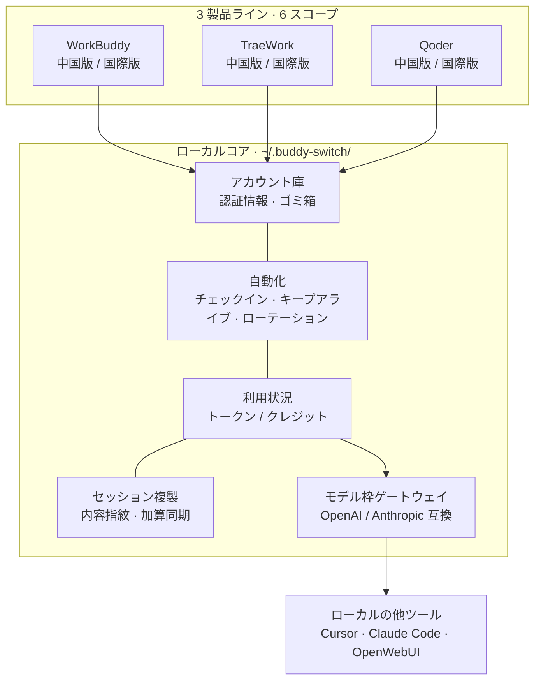
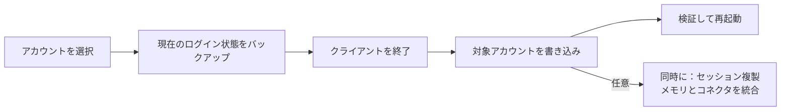
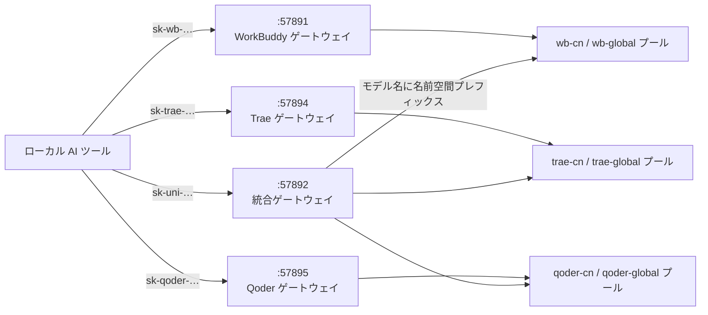
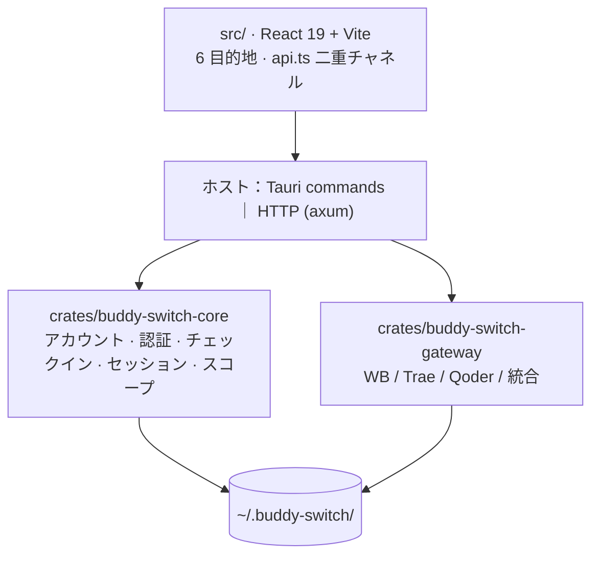

<p align="center">
  
</p>

<h1 align="center">Buddy Switch</h1>

<p align="center">
  <b>WorkBuddy · CodeBuddy · TraeWork · Qoder マルチアカウント管理ツール</b><br />
  「いまどのアカウントでログインしているか」をワンクリックに
</p>

<p align="center">
  
  <a href="https://github.com/NextAgentX/qoder-trae-workbuddy-switch/releases/latest"></a>
  <a href="./LICENSE"></a>
  <a href="https://github.com/NextAgentX/qoder-trae-workbuddy-switch/stargazers"></a>
</p>

<p align="center">
  <a href="README.cn.md">简体中文</a> ·
  <a href="README.md">English</a> ·
  <strong>日本語</strong> ·
  <a href="README.ko.md">한국어</a> ·
  <a href="README.ru.md">Русский</a> ·
  <a href="README.fr.md">Français</a> ·
  <a href="README.es.md">Español</a> ·
  <a href="README.pt.md">Português</a>
</p>

# Buddy Switch

**ローカル完結**のマルチアカウント管理ツールです。**WorkBuddy / CodeBuddy / TraeWork / Qoder** の 4 製品ライン、**6 つのスコープ**のアカウントを 1 か所に集約し、QR・デバイスコードでのログイン、ワンクリックのアカウント切り替え、チェックインとクレジット、利用状況の集計、セッション複製の同期、そしてモデル枠を OpenAI / Anthropic 互換 API としてローカルの他ツールに開放します。

|  |  |
| --- | --- |
| 🪪 **6 スコープを 1 画面で** | 3 製品ライン × 中国版 / 国際版。それぞれ独立したアカウント庫を持ち、切り替えは進捗を表示し、書き込み失敗時は自動で巻き戻します。 |
| ✅ **やるべきことが勝手に出てくる** | 概要が「再ログイン / 本日未チェックイン / 期限切れ間近のクレジット / クライアント未起動」を一覧化し、行内のボタンで片付きます。 |
| 📊 **利用量と制限が見える** | トークン、クレジット、アカウント × モデルの制限、どのセッション複製が遅れ・分岐したかまで一画面に。 |
| 🔌 **枠を他のツールにも** | OpenAI / Anthropic 互換エンドポイントとして公開し、Cursor・Claude Code・OpenWebUI にそのまま設定できます。 |

> **位置づけと利用範囲**
>
> 本プロジェクトは作者の**個人利用・学習**の産物です——自分自身の複数アカウント切り替えの手間を解消するために書きました。**参照・fork・改善は歓迎しますが、メンテナンスは約束しません**：商用サポート、SLA、特定クライアントバージョンとの互換性保証はありません。
>
> ライセンスは **PolyForm Noncommercial 1.0.0**：**個人の非商業利用のみ許可され、いかなる形の商業利用も禁止**されます（企業内の商業プロジェクト、SaaS／ホスティングサービス、販売、バンドル配布を含む）。商業利用には作者の事前の書面許可が必要です。

> ⚠️ **非公式・非商業**：WorkBuddy、CodeBuddy、TraeWork、Qoder およびその権利者との提携・承認・スポンサー・後援関係はありません。**商用利用はできません**。ローカルクライアントの認証データを読み書きし、設定したスケジュールで自動リクエストを送信し、ローカルポート経由で利用枠を転送できます。使用前に **[免責事項](docs/policies/DISCLAIMER.en.md)** を必ずお読みください。

## 画面

<table>
  <thead>
    <tr><th>概要（ライト）</th><th>概要（ダーク）</th></tr>
  </thead>
  <tbody>
    <tr>
      <td></td>
      <td></td>
    </tr>
  </tbody>
</table>

<table>
  <thead>
    <tr><th>WorkBuddy アカウント（ライト）</th><th>WorkBuddy アカウント（ダーク）</th></tr>
  </thead>
  <tbody>
    <tr>
      <td></td>
      <td></td>
    </tr>
  </tbody>
</table>

<table>
  <thead>
    <tr><th>利用状況・推移（ライト）</th><th>利用状況・推移（ダーク）</th></tr>
  </thead>
  <tbody>
    <tr>
      <td></td>
      <td></td>
    </tr>
  </tbody>
</table>

<table>
  <thead>
    <tr><th>ゲートウェイ（ライト）</th><th>ゲートウェイ（ダーク）</th></tr>
  </thead>
  <tbody>
    <tr>
      <td></td>
      <td></td>
    </tr>
  </tbody>
</table>

<table>
  <thead>
    <tr><th>Qoder ゲートウェイ (ライト)</th><th>Qoder ゲートウェイ (ダーク)</th></tr>
  </thead>
  <tbody>
    <tr>
      <td></td>
      <td></td>
    </tr>
  </tbody>
</table>

<details>
<summary><b>その他の画面（セッション / 設定 / TraeWork / Qoder）</b></summary>

<table>
  <thead>
    <tr><th>セッション (ライト)</th><th>セッション (ダーク)</th></tr>
  </thead>
  <tbody>
    <tr>
      <td></td>
      <td></td>
    </tr>
  </tbody>
</table>

<table>
  <thead>
    <tr><th>設定 (ライト)</th><th>設定 (ダーク)</th></tr>
  </thead>
  <tbody>
    <tr>
      <td></td>
      <td></td>
    </tr>
  </tbody>
</table>

<table>
  <thead>
    <tr><th>TraeWork アカウント (ライト)</th><th>TraeWork アカウント (ダーク)</th></tr>
  </thead>
  <tbody>
    <tr>
      <td></td>
      <td></td>
    </tr>
  </tbody>
</table>

<table>
  <thead>
    <tr><th>Qoder アカウント (ライト)</th><th>Qoder アカウント (ダーク)</th></tr>
  </thead>
  <tbody>
    <tr>
      <td></td>
      <td></td>
    </tr>
  </tbody>
</table>

</details>

> 画像は `scripts/gen-readme-shots.mjs` がデモビルド（`VITE_DEMO_MODE=1`）から自動生成しています。アカウント・クレジット・リクエスト記録はすべて架空です。UI を変えたら一度実行し直すだけです。

## 全体像



**3 つの不変ルール**：データは常にローカル、認証情報はクライアントのログイン状態に書き込むだけ（代理ログインや上流プロトコルの改変はしない）、書き込み前には必ずバックアップ。

## 4 つの形態

| 形態 | 入手方法 | 説明 |
| --- | --- | --- |
| **デスクトップアプリ** | [GitHub Releases](https://github.com/NextAgentX/qoder-trae-workbuddy-switch/releases/latest) からインストーラーを取得 | Tauri 製。日常利用に推奨 |
| **webui** | ソースからビルド（下記） | デスクトップ版と同じフロントエンド成果物をローカル HTTP で配信 |
| **Docker** | ビルド済みイメージ `ghcr.io/nextagentx/buddy-switch`（amd64 / arm64）を取得 | コンテナ内で動くのは **headless サーバー**（webui + API ゲートウェイ）で、デスクトップ版の切り替え機能は**ありません**。詳細は [Docker でのデプロイ](docs/guides/DOCKER.md) |
| **オンラインデモ** | [GitHub Pages](https://nextagentx.github.io/qoder-trae-workbuddy-switch/) | 読み取り専用。アカウントや利用量はすべて架空のデータ |

> npm パッケージは未公開のため `npm i -g` ではインストールできません。webui は下記のソースビルドをご利用ください。
>
> Docker 形態は**サーバーのみ**です。クライアントのログイン状態の切り替え、クライアントの起動、トレイ、フローティングウィンドウは**同じマシン上の GUI クライアント**が前提のため、コンテナ内では一切使えません。

## クイックスタート

**デスクトップアプリ**：Releases から OS 別のインストーラーをダウンロードします。

| プラットフォーム | インストーラー | インストール |
| --- | --- | --- |
| macOS Apple Silicon（arm64） | `BuddySwitch_<バージョン>_aarch64.dmg` | DMG を開き `BuddySwitch.app` を「アプリケーション」へ |
| macOS Intel（x86_64） | `BuddySwitch_<バージョン>_x86_64.dmg` | 同上 |
| Windows x64 | `BuddySwitch_<バージョン>_x64-setup.exe` | インストーラーを実行 |
| Linux x64 | `BuddySwitch_<バージョン>_amd64.deb` / `.AppImage` | `.deb` を導入、または AppImage に実行権限を付けて起動 |

**webui（ソースからビルド）**：フロントエンド成果物は**コンパイル時**にサーバーへ埋め込まれる（`rust-embed`）ため、順序を守る必要があります。

```bash
npm install
npm run build                                    # 1) フロントエンド → dist/
cargo build --release -p buddy-switch-server     # 2) サーバーをビルド（dist/ を埋め込み）
./target/release/buddy-switch                    # 3) 起動してブラウザを開く（127.0.0.1:57890）
```

```bash
buddy-switch              # 起動 + ブラウザを開く
buddy-switch serve        # サーバーのみ（--port でポート指定）
buddy-switch status       # 現在のアカウントを端末に表示
buddy-switch version      # バージョン
```

<details>
<summary><b>macOS：「開発元を検証できません」／切り替え時に権限エラー</b></summary>

- 開発元を検証できない場合：Finder でアプリを Control キーを押しながらクリック →「開く」、または「システム設定 → プライバシーとセキュリティ」で「このまま開く」。
- アカウント切り替えはクライアントの認証ファイルに書き込むため、「システム設定 → プライバシーとセキュリティ」の **アプリの管理**（または **フルディスクアクセス**）で BuddySwitch を許可し、アプリを再起動してください。設定画面の「権限チェック」でいつでも確認できます。
- webui 形態では、サービスを起動した端末プロセスの権限に従います。

</details>

## 6 つのスコープ（プラットフォーム × リージョン）

左上のスコープセレクターが「いま管理しているアカウント群」を決めます。スコープは URL に載る（`/s/wb-cn/accounts`）ため、再読み込み・リンク共有・戻る／進むでも同じ位置に留まります。`⌘K` / `Ctrl+K` でスコープ横断検索、`⌘1`–`⌘6` で直接切り替え。

| スコープ | プラットフォーム | リージョン | 管理対象クライアント |
| --- | --- | --- | --- |
| `wb-cn` | WorkBuddy | 中国版 | WorkBuddy デスクトップ、CodeBuddy CN IDE / CLI、VS Code / JetBrains の CodeBuddy 拡張 |
| `wb-global` | WorkBuddy | 国際版 | 同上（国際版クライアント） |
| `trae-cn` | TraeWork | 中国版 | Trae CN |
| `trae-global` | TraeWork | 国際版 | Trae |
| `qoder-cn` | Qoder | 中国版 | Qoder CN デスクトップ / CLI |
| `qoder-global` | Qoder | 国際版 | Qoder デスクトップ / CLI |

6 つのスコープは**完全に独立**しています（アカウント庫・クライアント・設定・ゲートウェイキーが別々）。Trae の旧プログラムライン（TraeWork / TraeCode）は上流で 1 つのクライアントに統合され、旧 ID は互換用にのみ残っています。

## サイドバーの 6 つの目的地

3 プラットフォームで**同一構成**：**概要 · アカウント · 利用状況 · セッション · ゲートウェイ · 設定**。表示は**ケイパビリティで制御**し（プラットフォーム分岐ではない）、機能がなければ入口を出さず、URL 直叩き時は構造化された空状態を返します。

| 目的地 | ひとことで |
| --- | --- |
| **概要** | 対応が必要な項目（再ログイン / 本日未チェックイン / 期限切れ間近のクレジット / クライアント未起動）+ 統計カード + 直近 14 日のトークン棒グラフ + 他スコープの概況 |
| **アカウント** | カード／テーブル表示、プログラムスロット、QR・デバイスコードログイン、ローカル取り込み、チェックイン、ゴミ箱（30 日）、レート制限台帳（WorkBuddy のみ） |
| **利用状況** | 1 つのワークベンチに 4 ビュー：推移 · モデル · セッション · クレジット。パラメータバーは 1 本だけ（期間 + データソース） |
| **セッション** | 同一セッションの各アカウント複製：どこが遅れ、どこが分岐し、どこへ同期するか（**WorkBuddy のみ**） |
| **ゲートウェイ** | 独立ゲートウェイ（スコープごと）と統合ゲートウェイ（スコープ横断で 1 プロバイダー） |
| **設定** | 9 区分：一般 · アカウントとログイン · チェックインとクレジット · ゲートウェイ · スケジュール · クライアント · 権限と診断 · ログ · バックアップと復元 |

### ケイパビリティ一覧

| ケイパビリティ | WorkBuddy | TraeWork | Qoder |
| --- | :---: | :---: | :---: |
| アカウント庫 / ログイン / ローカル取り込み | ✅ QR + 取り込み | ✅ Web ログイン + JWT | ✅ デバイスコード + PAT |
| プログラムスロット | ✅ 5（4 切り替え可 + 1 読み取り専用） | ✅ 1（統合クライアント） | ✅ 2（デスクトップ / CLI） |
| チェックイン / クレジット | ✅ 自動トラベル・自動ローテーション込み | ✅ | ✅ 毎日チェックイン + プラン / 枠 |
| 利用状況の集計 | ✅ トークン + クレジット | ✅ トークン + クレジット | ✅ クレジットのみ（クライアントはトークン数を常に 0 で保存） |
| セッション複製の同期 | ✅ 内容指紋 + 加算同期 | — | — |
| モデル枠ゲートウェイ | ✅ `:57891` | ✅ `:57894` | ✅ `:57895` |

## アカウント切り替えの流れ



- **書き込み前にバックアップ**：認証ファイル、Trae のログインスナップショット、セッション上書き前のいずれも復元可能なコピーを残します。
- **書き込み後に検証**：失敗すれば自動で巻き戻し。クライアント起動中は書き込みを拒否し、終了時にメモリ上の古い状態で上書きされるのを防ぎます。
- **削除は論理削除**：30 日間ゴミ箱に残り、いつでも復元可能。完全削除で認証情報とスナップショットも消えます。

## モデル枠ゲートウェイ

現在のアカウントの枠をローカルツールへ開放します。OpenAI 互換（`/v1/models`、`/v1/chat/completions`、`/v1/responses`）と Anthropic 互換（`/v1/messages`）、いずれも SSE ストリーミング対応。既定ではループバックのみ待ち受けます。



- **4 つのリスナーは独立**：ポートは **`5789x` の一段**に揃えています（`57890` 画面 · `57891` WorkBuddy · `57892` 統合 · `57893` セッション hook · `57894` Trae · `57895` Qoder）。統合ゲートウェイを切っても既存クライアントに影響なし。`/v1/*` のルートが完全に重複するため、1 つの Router に統合することは**できません**。
- **Key のプレフィックスは同族**：`sk-wb-` · `sk-trae-` · **`sk-qoder-`** · `sk-uni-`。プレフィックスを見れば設定すべきポートが分かります。
- **キーの 3 状態**：失効 · 復元 · 削除（失効済みのみ削除可）。平文は作成時に一度だけ返し、保存するのは sha256 と前後 4 文字のみ。
- **キーの割当量と許可アカウント**：キーごとに「上限 × リセット周期」を設定でき（単位はトークンかリクエスト数の二択、周期はリセットなし / 毎日 / 毎週 / 暦月）、使用できるアカウントも限定できます（グループ単位で一括選択可）。超過時は 429 `quota_exceeded`、許可アカウントが全滅している場合は 401 `no_credential`（プール空と同じコード。`message` に許可リストが何件をカバーしているかと不可用の理由が出ます）を返し、**全アカウントプールへはフォールバックしません**。
- **アカウントプール**：残高とレート制限状態で選択、利用不可アカウントの除外、「アカウント × モデル」の制限プローブ、復旧後のワンクリック復帰。

**統合ゲートウェイ**は「同名モデルがプラットフォーム間で上書きし合う」問題を解決します。モデル名を `<名前空間>:<モデル ID>` とし、名前空間はスコープ登録表から導出（現在 6 件：`wb-cn` / `wb-global` / `trae-cn` / `trae-global` / `qoder-cn` / `qoder-global`）。

| ルール | 挙動 |
| --- | --- |
| プレフィックスなしのモデル名 | **必ず 400**。有効なプレフィックス一覧を返す（既定値を推測して別プールへ静かに流すことを避ける） |
| 名前空間の解析 | **セグメント全体の完全一致のみ**（`trae` / `traework` / `traecode` は互いに接頭辞） |
| 1 つのキーで複数プラットフォーム | 同一の `sk-uni-` キーで複数プラットフォームを同時に認可 |
| `/v1/responses` | すべての名前空間で利用可（Trae は 2026-10-22 に対応。Qoder は内部で chat に変換） |
| 既定状態 | **オフ**。ゲートウェイ画面の「統合ゲートウェイ」区分で有効化 |

> 設計：[UNIFIED-GATEWAY-ARCH.md](docs/specs/UNIFIED-GATEWAY-ARCH.md) · 接続例：[guides/GATEWAY-CLIENT-INTEGRATION.md](docs/guides/GATEWAY-CLIENT-INTEGRATION.md)

## 自動化

スケジュールは**分単位**の時刻（例 `09:37`）、複数時刻、**ランダムゆらぎ**（±5/15/30 分）に対応し、毎日の実行時刻を分散できます。

| 側 | タスク |
| --- | --- |
| WorkBuddy（6 種） | チェックイン · 猫の旅 · アクティブマップ · トークン維持 · 新学期 · 夜更かし |
| Trae（2 種） | チェックイン · JWT 自動更新 |
| Qoder（2 種） | チェックイン · トークン維持 |

自動ローテーション（WorkBuddy のみ）は**独立したバックグラウンドループ**で、スケジュール表の項目ではありません（下記参照）。

<details>
<summary><b>自動ローテーションの方針（WorkBuddy・クレジット失効対策）</b></summary>

バックグラウンドで、**次回以降の CodeBuddy CLI 起動**が使う既定アカウントを「最も切迫した」アカウント（最も早く期限が来て、まだクレジットが残るもの）に設定します。判定順：

1. 有効なアカウント（照会成功・未失効・残高あり）
2. 切迫度（最も切迫した残りが `min_urgency_hours`（既定 72h）を超える → 切り替えない）
3. すでにそのアカウント → 切り替えない
4. クールダウン（`cooldown_minutes`、既定 120）
5. アクティブ保護（直近 `active_guard_minutes`（既定 30）以内に対話 → 切り替えない）
6. 価値フィルタ（残高が `min_remaining_credits` 未満 → 切り替える価値なし）
7. ばたつき防止（差が `min_gap_hours`（既定 24）未満 → 切り替えない）

**適用範囲**：以後のセッションが使う既定アカウントのみを更新し、実行中のセッションは切り替えません。ACP でセッションを再読み込みするか CLI を再起動してください。

</details>

<details>
<summary><b>アプリ共通機能（6 スコープ共通・スコープ切替の影響なし）</b></summary>

| 機能 | 説明 |
| --- | --- |
| アプリ設定（⚙） | テーマ（ライト / ダーク / システム）、UI 言語（簡体中文 / English）、トレイへの静か起動、閉じてもトレイに残す、自動更新 |
| 全体バックアップと復元 | 全スコープを一括対象。アカウント / 設定 / ゲートウェイで選択、**既定では認証情報を含まない** |
| Skill 管理 | `skills/*/SKILL.md` を走査し項目ごとに有効・無効化（行単位の書き換えで他のバイトは保持）、リージョン間の移行、zip 取り込み |
| クライアント設定の集中管理 | 上流クライアント自身の `settings.json` を読み書き：6 スロット仕様表 + 形式指紋 + バイト単位の最小パッチ + バックアップ / 復元 / 差分 |
| セッション小窓（デスクトップのみ） | 複数ソースのタスク状態を常時表示する小窓。読み取り専用、クリックで元のセッションへ |
| クライアントセッション監視（既定オフ） | WorkBuddy の `settings.json` にフックを入れ、タスク状態を小窓へ送信（受信側 `127.0.0.1:57893`） |
| 実行ログ | 本ツール**自身**のログ（`~/.buddy-switch/logs/runtime-YYYY-MM-DD.log`）。「設定 → ログ」でレベル / 日付 / キーワードで絞り込み、コピー・フォルダを開く・消去が可能。7 日保持、1 ファイル 4 MiB・1 日 4 分割まで。書き込み前に認証情報を伏せ字化。`BUDDY_SWITCH_LOG_LEVEL=debug` で再起動するとリクエスト単位の詳細が出ます |

</details>

## データとプライバシー

- データはすべてローカルの `~/.buddy-switch/` に保存され、外部サービスへ送信しません。UI 設定もローカルのみ。
- アカウント庫はスコープごとに分離（例：`accounts.json` / `accounts.global.json`、`trae/checkin_accounts*.json`）。
- エクスポートしたバックアップは**既定でトークンを含みません**。明示的にチェックし二重確認した場合のみ平文を書き込み、そのファイルで直接ログインできる旨を画面に警告します。
- ゲートウェイキーはハッシュと前置きのみ保存。**ローカルデータはコミットせず**、リリース前にトークンパターンを走査します。

## 開発



```bash
npm install
npm run tauri dev     # デスクトップ開発
npm run build         # フロントエンドビルド + 契約 / スコープ / プラットフォーム検査
npm run check:api     # API 契約検査のみ
```

```
crates/
  buddy-switch-core/     # アカウント、認証、OAuth、プロセス、切り替え、セッション、チェックイン、リージョン、Trae / Qoder モジュール
  buddy-switch-gateway/  # OpenAI / Anthropic 互換ゲートウェイ（WB / Trae / Qoder / 統合の 4 実装）
  buddy-switch-server/   # HTTP サーバー + CLI（axum API + rust-embed 埋め込みフロントエンド）
src-tauri/               # デスクトップホスト（Tauri 薄ラッパー + トレイ + ゲートウェイホスト）
src/                     # フロントエンド：components / pages / lib / locales
npm/                     # npm パッケージ（未公開）
```

## ドキュメント

全体の索引は [docs/README.md](docs/README.md) にあります（ガイド / 現行仕様 / 読み取り専用の履歴 / プロトタイプ）。よく参照するもの:

| ドキュメント | 内容 |
| --- | --- |
| [guides/DEVELOPMENT.md](docs/guides/DEVELOPMENT.md) | 環境要件・ローカル開発・ゲート一覧・リリース手順・構成の規約 |
| [guides/DOCKER.md](docs/guides/DOCKER.md) | コンテナでのデプロイ: ビルド済みイメージ / ソースからのビルド、ポートとセキュリティ、トラブルシューティング |
| [guides/GATEWAY-CLIENT-INTEGRATION.md](docs/guides/GATEWAY-CLIENT-INTEGRATION.md) | Codex / Claude Code などのクライアントをローカルゲートウェイに接続する |
| [specs/](docs/specs/) | 現行のアーキテクチャと決定（コードを変える前に読む） |
| [policies/](docs/policies/) | ライセンスと免責事項 |

## コントリビューション

**このプロジェクトは貢献で育ってきました**：Qoder 対応、統合ゲートウェイ、スケジュールのゆらぎ、多言語 README はすべて Issue と PR から生まれています。専門家である必要はありません。

| | |
| --- | --- |
| 🐞 **不具合を報告** | バージョンとログのスクリーンショットを添えて [Issue を作成](https://github.com/NextAgentX/qoder-trae-workbuddy-switch/issues/new) |
| 🧩 **プラットフォームを追加** | 差異は `src/lib/platforms/registry.ts` と `product.rs` に一度だけ宣言すればよく、ページ側は変更不要です。 |
| 🌍 **翻訳の修正** | UI 文言は `src/locales/domains/*.zh.ts` ↔ `*.en.ts` が対になっています。8 言語の README 校訂も歓迎です。 |
| 📸 **スクリーンショット更新** | 1 コマンドでライト/ダークの全画像を撮り直せます（`scripts/gen-readme-shots.mjs` の冒頭コメント参照）。 |
| 🧪 **テストを追加** | このリポジトリのガードテストの多くは貢献者が追加したものです。まず `docs/guides/DEVELOPMENT.md` のゲート一覧から。 |

詳しい案内（取り組めること、PR チェックリスト、コード規約）：**[CONTRIBUTING.en.md](CONTRIBUTING.en.md)**（[简体中文](CONTRIBUTING.md)）。

## プロジェクトを支援する

- ☕ **作者に一杯おごる**（任意。機能制限は一切ありません。商業ライセンスにもなりません）

<table>
  <thead>
    <tr><th>WeChat Pay</th><th>Alipay</th></tr>
  </thead>
  <tbody>
    <tr>
      <td></td>
      <td></td>
    </tr>
  </tbody>
</table>

## 謝辞

- [changexbc/workbuddy-switch](https://github.com/changexbc/workbuddy-switch) — WorkBuddy のアカウントデータ形式とマルチアカウント切り替えの考え方を参考にしました。
- [Sliverkiss/workbuddy2api](https://github.com/Sliverkiss/workbuddy2api) — モデル枠を OpenAI 互換 API として公開するアイデアを参考にしました。

各プロジェクトはそれぞれのライセンスに従います。本プロジェクトは独立した実装であり、提携・協力・後援関係はなく、名称および商標は各権利者に帰属します。

## 免責事項

全文は **[docs/policies/DISCLAIMER.en.md](docs/policies/DISCLAIMER.en.md)**（[简体中文](docs/policies/DISCLAIMER.md)）。全 7 条：非公式サードパーティ製ツール、利用規約とコンプライアンスの自己責任、データ書き込みとバックアップ、自動化行為のリスク、API ゲートウェイ公開のリスク、現状のまま提供、利用制限（商用禁止・課金回避の禁止）。使用した時点で同意したものとみなします。同意できない場合は直ちに使用を中止しアンインストールしてください。

## ライセンス

**[PolyForm Noncommercial License 1.0.0](./LICENSE)**：個人の非商業利用は許可、**商業利用は許諾されません**。

- 全文：[LICENSE](./LICENSE)
- 平易な解説と FAQ：[docs/policies/LICENSING.en.md](docs/policies/LICENSING.en.md)（[简体中文](docs/policies/LICENSING.md)）
- 商業ライセンスについては本リポジトリの Issues でご連絡ください。
- **寄付はライセンスと無関係**：任意の贈与であり、購入・商業ライセンス・役務提供の約束ではありません。
- 本プロジェクトは**個人プロジェクト**です。商用サポート、SLA、メンテナンスの約束はありません。Issue と PR にはできる範囲で対応しますが、期限は保証しません。

## Star 推移

<a href="https://www.star-history.com/?repos=NextAgentX%2Fqoder-trae-workbuddy-switch&type=date&legend=top-left">

 <picture>
   <source media="(prefers-color-scheme: dark)" srcset="https://api.star-history.com/chart?repos=NextAgentX/qoder-trae-workbuddy-switch&type=date&theme=dark&legend=top-left" />
   <source media="(prefers-color-scheme: light)" srcset="https://api.star-history.com/chart?repos=NextAgentX/qoder-trae-workbuddy-switch&type=date&legend=top-left" />
   
 </picture>
</a>
