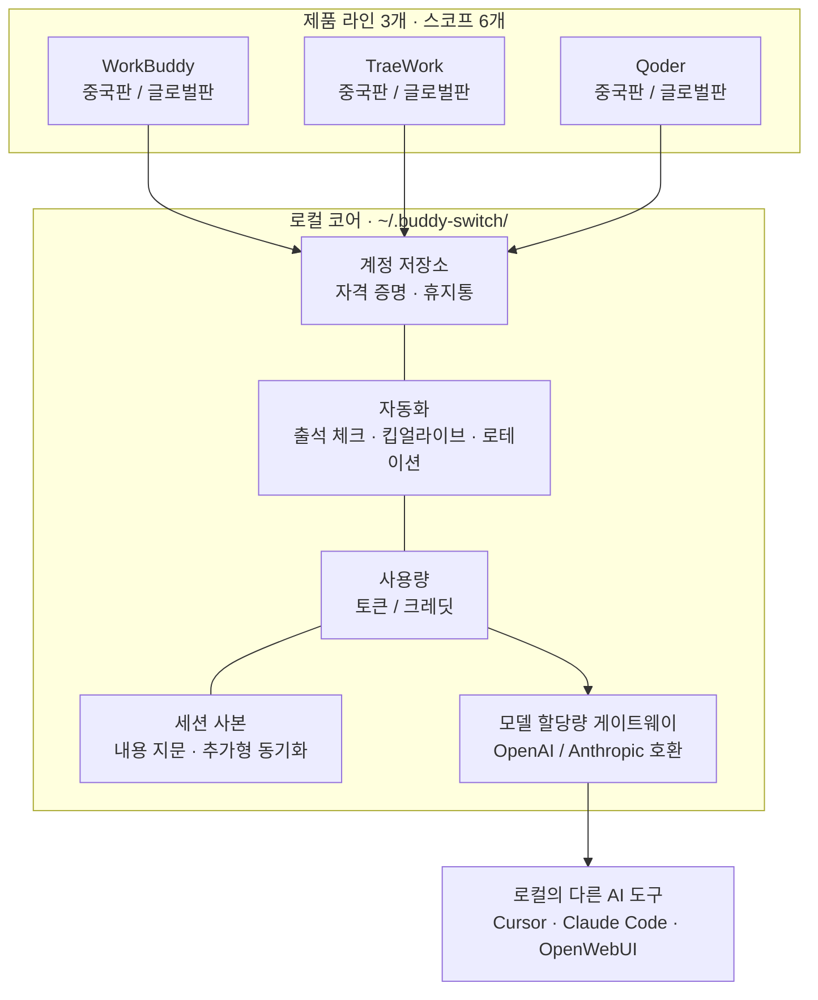
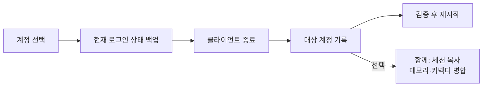
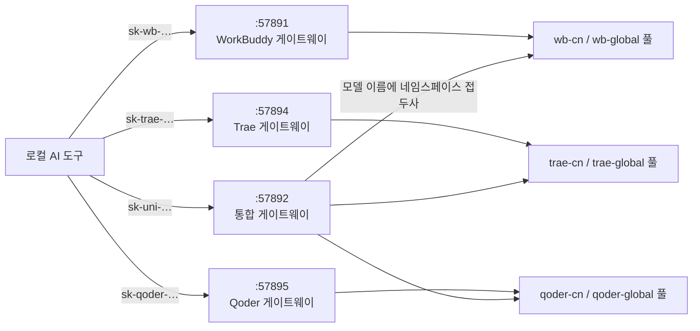
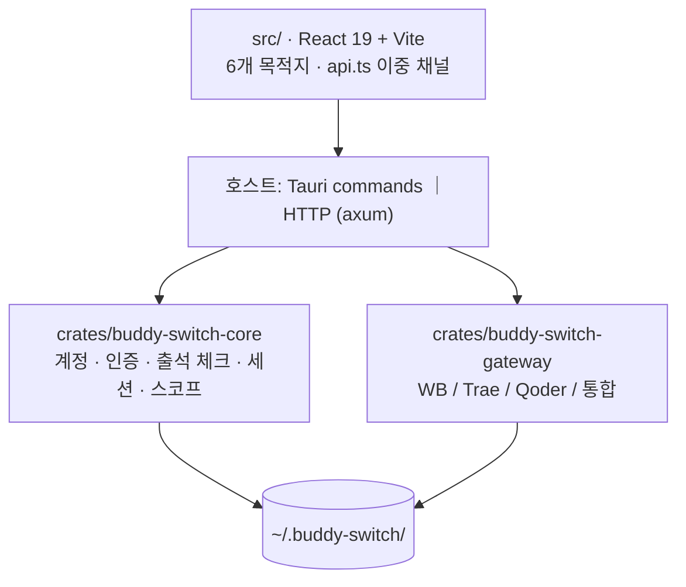

<p align="center">
  
</p>

<h1 align="center">Buddy Switch</h1>

<p align="center">
  <b>WorkBuddy · CodeBuddy · TraeWork · Qoder 멀티 계정 워크벤치</b><br />
  “지금 어느 계정으로 로그인했는지”를 클릭 한 번으로
</p>

<p align="center">
  
  <a href="https://github.com/NextAgentX/qoder-trae-workbuddy-switch/releases/latest"></a>
  <a href="./LICENSE"></a>
  <a href="https://github.com/NextAgentX/qoder-trae-workbuddy-switch/stargazers"></a>
</p>

<p align="center">
  <a href="README.cn.md">简体中文</a> ·
  <a href="README.md">English</a> ·
  <a href="README.ja.md">日本語</a> ·
  <strong>한국어</strong> ·
  <a href="README.ru.md">Русский</a> ·
  <a href="README.fr.md">Français</a> ·
  <a href="README.es.md">Español</a> ·
  <a href="README.pt.md">Português</a>
</p>

# Buddy Switch

**로컬에서 동작하는** 멀티 계정 워크벤치입니다. **WorkBuddy / CodeBuddy / TraeWork / Qoder** 네 제품 라인, **6개 스코프**의 계정을 한곳에 모아 QR·기기 코드 로그인, 원클릭 계정 전환, 출석 체크와 크레딧, 사용량 통계, 세션 사본 동기화를 제공하고, 모델 할당량을 OpenAI / Anthropic 호환 API로 로컬의 다른 AI 도구에 개방합니다.

|  |  |
| --- | --- |
| 🪪 **6개 스코프를 한 화면에** | 세 제품 라인 × 중국판 / 글로벌판. 각자 독립된 계정 저장소를 가지며, 전환 시 진행 상황을 보여주고 쓰기 실패 시 자동으로 되돌립니다. |
| ✅ **할 일이 알아서 드러납니다** | 개요가 「재로그인 / 오늘 미출석 / 만료 예정 크레딧 / 클라이언트 미실행」을 목록으로 보여주고, 행 안의 버튼으로 바로 처리합니다. |
| 📊 **사용량과 제한이 보입니다** | 토큰, 크레딧, 계정 × 모델 제한, 어떤 세션 사본이 뒤처지고 갈라졌는지까지 한 화면에. |
| 🔌 **할당량을 다른 도구에 연결** | OpenAI / Anthropic 호환 엔드포인트로 노출해 Cursor, Claude Code, OpenWebUI에 그대로 설정할 수 있습니다. |

> **성격과 이용 범위**
>
> 이 프로젝트는 작성자의 **개인 사용·학습** 결과물입니다. 작성자 자신의 다중 계정 전환 번거로움을 해결하려고 만들었습니다. **참고·fork·개선은 환영하지만 유지보수를 약속하지는 않습니다**: 상업적 지원, SLA, 특정 클라이언트 버전과의 호환성 보장은 없습니다.
>
> 라이선스는 **PolyForm Noncommercial 1.0.0**이며, **개인적 비상업적 사용만 허용되고 모든 형태의 상업적 사용은 금지**됩니다(기업 내부 상업 프로젝트, SaaS·호스팅 서비스, 판매, 번들 배포 포함). 상업적 사용에는 작성자의 사전 서면 허가가 필요합니다.

> ⚠️ **비공식 · 비상업**: WorkBuddy, CodeBuddy, TraeWork, Qoder 및 그 권리자와 제휴·승인·후원·보증 관계가 없습니다. **상업적으로 사용할 수 없습니다**. 로컬 클라이언트의 인증 데이터를 읽고 쓰며, 설정한 스케줄대로 자동 요청을 보내고, 로컬 포트를 통해 할당량을 전달할 수 있습니다. 사용 전에 **[면책 고지](docs/policies/DISCLAIMER.en.md)** 를 반드시 읽어 주세요.

## 화면

<table>
  <thead>
    <tr><th>개요(라이트)</th><th>개요(다크)</th></tr>
  </thead>
  <tbody>
    <tr>
      <td></td>
      <td></td>
    </tr>
  </tbody>
</table>

<table>
  <thead>
    <tr><th>WorkBuddy 계정(라이트)</th><th>WorkBuddy 계정(다크)</th></tr>
  </thead>
  <tbody>
    <tr>
      <td></td>
      <td></td>
    </tr>
  </tbody>
</table>

<table>
  <thead>
    <tr><th>사용량 · 추세(라이트)</th><th>사용량 · 추세(다크)</th></tr>
  </thead>
  <tbody>
    <tr>
      <td></td>
      <td></td>
    </tr>
  </tbody>
</table>

<table>
  <thead>
    <tr><th>게이트웨이(라이트)</th><th>게이트웨이(다크)</th></tr>
  </thead>
  <tbody>
    <tr>
      <td></td>
      <td></td>
    </tr>
  </tbody>
</table>

<table>
  <thead>
    <tr><th>Qoder 게이트웨이 (라이트)</th><th>Qoder 게이트웨이 (다크)</th></tr>
  </thead>
  <tbody>
    <tr>
      <td></td>
      <td></td>
    </tr>
  </tbody>
</table>

<details>
<summary><b>더 많은 화면(세션 / 설정 / TraeWork / Qoder)</b></summary>

<table>
  <thead>
    <tr><th>세션 (라이트)</th><th>세션 (다크)</th></tr>
  </thead>
  <tbody>
    <tr>
      <td></td>
      <td></td>
    </tr>
  </tbody>
</table>

<table>
  <thead>
    <tr><th>설정 (라이트)</th><th>설정 (다크)</th></tr>
  </thead>
  <tbody>
    <tr>
      <td></td>
      <td></td>
    </tr>
  </tbody>
</table>

<table>
  <thead>
    <tr><th>TraeWork 계정 (라이트)</th><th>TraeWork 계정 (다크)</th></tr>
  </thead>
  <tbody>
    <tr>
      <td></td>
      <td></td>
    </tr>
  </tbody>
</table>

<table>
  <thead>
    <tr><th>Qoder 계정 (라이트)</th><th>Qoder 계정 (다크)</th></tr>
  </thead>
  <tbody>
    <tr>
      <td></td>
      <td></td>
    </tr>
  </tbody>
</table>

</details>

> 이미지는 `scripts/gen-readme-shots.mjs`가 데모 빌드(`VITE_DEMO_MODE=1`)에서 자동 생성합니다. 계정·크레딧·요청 기록은 모두 가상 데이터이며, UI가 바뀌면 한 번 다시 실행하면 됩니다.

## 전체 구조



**세 가지 원칙**이 모든 기능에 적용됩니다. 데이터는 항상 로컬에만, 자격 증명은 클라이언트 로그인 상태에 기록만(대리 로그인·업스트림 프로토콜 변경 없음), 모든 쓰기 전 백업.

## 네 가지 형태

| 형태 | 얻는 방법 | 설명 |
| --- | --- | --- |
| **데스크톱 앱** | [GitHub Releases](https://github.com/NextAgentX/qoder-trae-workbuddy-switch/releases/latest) 에서 설치 파일 다운로드 | Tauri 패키지, 일상 사용에 권장 |
| **webui** | 소스에서 빌드(아래 참조) | 데스크톱 앱과 동일한 프런트엔드 산출물을 로컬 HTTP로 제공 |
| **Docker** | 사전 빌드 이미지 `ghcr.io/nextagentx/buddy-switch`(amd64 / arm64) 받기 | 컨테이너에서 도는 것은 **headless 서버**(webui + API 게이트웨이)이며 데스크톱 전환기가 **아닙니다**. [Docker 배포](docs/guides/DOCKER.md) 참고 |
| **온라인 데모** | [GitHub Pages](https://nextagentx.github.io/qoder-trae-workbuddy-switch/) | 읽기 전용 데모, 계정·사용량은 모두 가상 데이터 |

> npm 패키지는 아직 배포되지 않아 `npm i -g` 로는 설치되지 않습니다. webui는 아래 소스 빌드를 사용하세요.
>
> Docker 형태는 **서버 전용**입니다. 클라이언트 로그인 상태 전환, 클라이언트 실행, 트레이, 플로팅 창은 **같은 머신의 GUI 클라이언트**가 필요하므로 컨테이너 안에서는 모두 사용할 수 없습니다.

## 빠른 시작

**데스크톱 앱**: Releases에서 플랫폼별 설치 파일을 받습니다.

| 플랫폼 | 설치 파일 | 설치 |
| --- | --- | --- |
| macOS Apple Silicon(arm64) | `BuddySwitch_<버전>_aarch64.dmg` | DMG를 열고 `BuddySwitch.app`을 응용 프로그램으로 이동 |
| macOS Intel(x86_64) | `BuddySwitch_<버전>_x86_64.dmg` | 위와 동일 |
| Windows x64 | `BuddySwitch_<버전>_x64-setup.exe` | 설치 프로그램 실행 |
| Linux x64 | `BuddySwitch_<버전>_amd64.deb` / `.AppImage` | `.deb` 설치 또는 AppImage에 실행 권한 부여 후 실행 |

**webui(소스 빌드)**: 프런트엔드 산출물은 **컴파일 시점**에 서버에 내장되므로(`rust-embed`) 순서를 지켜야 합니다.

```bash
npm install
npm run build                                    # 1) 프런트엔드 → dist/
cargo build --release -p buddy-switch-server     # 2) 서버 빌드(dist/ 내장)
./target/release/buddy-switch                    # 3) 서비스 시작 + 브라우저 열기(127.0.0.1:57890)
```

```bash
buddy-switch              # 서비스 시작 + 브라우저 열기
buddy-switch serve        # 서비스만 시작(--port 로 포트 지정)
buddy-switch status       # 터미널에서 현재 계정 확인
buddy-switch version      # 버전
```

<details>
<summary><b>macOS: "개발자를 확인할 수 없음" / 전환 시 권한 오류</b></summary>

- 개발자를 확인할 수 없음: Finder에서 Control 키를 누른 채 앱 클릭 → "열기", 또는 시스템 설정 → 개인정보 보호 및 보안 → "확인 없이 열기".
- 계정 전환은 클라이언트 인증 파일에 기록하므로 시스템 설정 → 개인정보 보호 및 보안의 **앱 관리**(또는 **전체 디스크 접근 권한**)에서 BuddySwitch를 허용한 뒤 앱을 재시작하세요. 설정 화면의 "권한 검사"로 언제든 확인할 수 있습니다.
- webui 형태는 서비스를 시작한 터미널 프로세스의 권한을 따릅니다.

</details>

## 6개 스코프(플랫폼 × 리전)

좌측 상단 스코프 선택기가 "지금 어느 계정 집합을 관리하는지"를 결정합니다. 스코프는 URL에 담기므로(`/s/wb-cn/accounts`) 새로고침·링크 공유·앞뒤 이동에도 위치가 유지됩니다. `⌘K` / `Ctrl+K` 로 스코프를 넘나들며 검색하고 `⌘1`–`⌘6` 으로 바로 전환합니다.

| 스코프 | 플랫폼 | 리전 | 관리 대상 클라이언트 |
| --- | --- | --- | --- |
| `wb-cn` | WorkBuddy | 중국판 | WorkBuddy 데스크톱, CodeBuddy CN IDE / CLI, VS Code / JetBrains용 CodeBuddy 확장 |
| `wb-global` | WorkBuddy | 글로벌판 | 위와 동일(글로벌 클라이언트) |
| `trae-cn` | TraeWork | 중국판 | Trae CN |
| `trae-global` | TraeWork | 글로벌판 | Trae |
| `qoder-cn` | Qoder | 중국판 | Qoder CN 데스크톱 / CLI |
| `qoder-global` | Qoder | 글로벌판 | Qoder 데스크톱 / CLI |

6개 스코프는 **완전히 독립**입니다(계정 저장소·클라이언트·설정·게이트웨이 키 분리). Trae의 두 레거시 프로그램 라인(TraeWork / TraeCode)은 업스트림에서 하나의 클라이언트로 통합되었고, 예전 식별자는 호환용으로만 남아 있습니다.

## 사이드바의 6개 목적지

세 플랫폼이 **항목별로 동일**합니다: **개요 · 계정 · 사용량 · 세션 · 게이트웨이 · 설정**. 표시 여부는 **기능(케이퍼빌리티) 게이팅**으로 결정되며(플랫폼 분기 아님), 기능이 없으면 항목을 그리지 않고 URL 직접 접근 시에는 구조화된 빈 상태를 반환합니다.

| 목적지 | 한 줄 설명 |
| --- | --- |
| **개요** | 처리할 항목(재로그인 / 오늘 미출석 / 만료 예정 크레딧 / 클라이언트 미실행) + 통계 카드 + 최근 14일 토큰 막대 차트 + 다른 스코프 요약 |
| **계정** | 카드·표 두 가지 보기, 프로그램 슬롯, QR·기기 코드 로그인, 로컬 가져오기, 출석 체크, 휴지통(30일), 레이트 리밋 원장(WorkBuddy 전용) |
| **사용량** | 하나의 워크벤치에 네 가지 뷰: 추세 · 모델 · 세션 · 크레딧. 파라미터 바는 하나(기간 + 데이터 소스) |
| **세션** | 같은 세션의 계정별 사본: 누가 뒤처지고, 누가 갈라졌고, 누구에게 동기화할지(**WorkBuddy 전용**) |
| **게이트웨이** | 독립 게이트웨이(스코프별)와 통합 게이트웨이(스코프를 아우르는 단일 provider) |
| **설정** | 9개 구역: 일반 · 계정과 로그인 · 출석 체크와 크레딧 · 게이트웨이 · 예약 작업 · 클라이언트 · 권한과 진단 · 로그 · 백업과 복원 |

### 기능 매트릭스

| 기능 | WorkBuddy | TraeWork | Qoder |
| --- | :---: | :---: | :---: |
| 계정 저장소 / 로그인 / 로컬 가져오기 | ✅ QR + 가져오기 | ✅ 웹 로그인 + JWT | ✅ 기기 코드 + PAT |
| 프로그램 슬롯 | ✅ 5개(전환 4 + 읽기 전용 1) | ✅ 1개(통합 클라이언트) | ✅ 2개(데스크톱 / CLI) |
| 출석 체크 / 크레딧 | ✅ 자동 여행·자동 로테이션 포함 | ✅ | ✅ 매일 출석 + 플랜 / 할당량 |
| 사용량 통계 | ✅ 토큰 + 크레딧 | ✅ 토큰 + 크레딧 | ⏳ 데이터 소스 미연결 |
| 세션 사본 동기화 | ✅ 내용 지문 + 추가형 동기화 | — | — |
| 모델 할당량 게이트웨이 | ✅ `:57891` | ✅ `:57894` | ✅ `:57895` |

## 계정 전환 방식



- **쓰기 전 백업**: 인증 파일, Trae 로그인 스냅샷, 세션 덮어쓰기 모두 되돌릴 수 있는 사본을 남깁니다.
- **쓰기 후 검증**: 실패하면 자동 복원. 클라이언트가 실행 중이면 쓰기를 거부해 종료 시 메모리의 옛 상태로 덮어쓰는 일을 막습니다.
- **삭제는 소프트 삭제**: 30일 동안 휴지통에 보관되고 언제든 복원할 수 있으며, 영구 삭제 시에만 자격 증명과 스냅샷이 함께 지워집니다.

## 모델 할당량 게이트웨이

현재 계정의 할당량을 로컬 도구에 개방합니다. OpenAI 호환(`/v1/models`, `/v1/chat/completions`, `/v1/responses`)과 Anthropic 호환(`/v1/messages`), 모두 SSE 스트리밍을 지원합니다. 기본적으로 루프백만 수신합니다.



- **네 개의 리스너는 독립적**: 포트는 하나의 **`5789x` 구간**으로 정리했습니다(`57890` UI · `57891` WorkBuddy · `57892` 통합 · `57893` 세션 hook · `57894` Trae · `57895` Qoder). 통합 게이트웨이를 꺼도 기존 클라이언트에 영향이 없습니다. `/v1/*` 라우트가 완전히 겹치므로 하나의 Router로 합칠 수 **없습니다**.
- **Key 접두사는 한 계열**: `sk-wb-` · `sk-trae-` · **`sk-qoder-`** · `sk-uni-`. 접두사만 보면 어느 포트에 연결할지 알 수 있습니다.
- **키 3단계 상태**: 폐기 · 복구 · 삭제(폐기된 키만 삭제 가능). 평문은 생성 시 한 번만 반환하고 저장소에는 sha256과 앞/뒤 4자만 남깁니다.
- **키 할당량 및 허용 계정**: 키마다 "상한 × 초기화 주기"를 설정하고(단위는 토큰 또는 요청 수 중 택 1, 주기는 초기화 없음 / 매일 / 매주 / 역월), 사용할 수 있는 계정도 제한할 수 있습니다(그룹 단위 일괄 선택 가능). 초과 시 429 `quota_exceeded`, 허용된 계정이 모두 사용 불가면 401 `no_credential`(풀 비어 있음과 같은 코드이며, `message`에 허용 목록이 몇 개를 포함하는지와 사용 불가 사유가 표시됩니다)을 반환하며 **전체 풀로 대체하지 않습니다**.
- **계정 풀**: 잔액과 레이트 리밋 상태로 계정을 선택하고, 사용 불가 계정을 제외하며, "계정 × 모델" 리밋을 탐지하고 복구 후 원클릭으로 되살립니다.

**통합 게이트웨이**는 "같은 이름의 모델이 플랫폼 간에 서로를 덮어쓰는" 문제를 해결합니다. 모델 이름을 `<네임스페이스>:<모델 id>` 로 쓰고, 네임스페이스는 스코프 레지스트리에서 파생됩니다(현재 6개: `wb-cn` / `wb-global` / `trae-cn` / `trae-global` / `qoder-cn` / `qoder-global`).

| 규칙 | 동작 |
| --- | --- |
| 접두사 없는 모델 이름 | **항상 400**, 사용 가능한 접두사 목록을 함께 반환(기본값을 추측해 조용히 다른 풀로 보내지 않음) |
| 네임스페이스 해석 | **전체 세그먼트 정확 일치만**(`trae` / `traework` / `traecode` 는 서로의 접두사) |
| 하나의 키로 여러 플랫폼 | 동일한 `sk-uni-` 키로 여러 플랫폼 동시 인가 |
| `trae-*` 의 `/v1/responses` | **501** 반환, chat으로 조용히 강등하지 않음 |
| 기본 상태 | **꺼짐**. 게이트웨이 화면의 "통합 게이트웨이" 구역에서 직접 켜야 함 |

> 설계: [UNIFIED-GATEWAY-ARCH.md](docs/specs/UNIFIED-GATEWAY-ARCH.md) · 연결 예시: [guides/GATEWAY-CLIENT-INTEGRATION.md](docs/guides/GATEWAY-CLIENT-INTEGRATION.md)

## 자동화

예약 작업은 **분 단위** 시각(예: `09:37`), 여러 시각, **랜덤 지터**(±5/15/30분)를 지원해 매일 실행 시각을 흩뜨립니다.

| 측 | 작업 |
| --- | --- |
| WorkBuddy(6종) | 출석 체크 · 고양이 여행 · 액티브 맵 · 토큰 킵얼라이브 · 개학 시즌 · 야행성 |
| Trae(2종) | 출석 체크 · JWT 자동 갱신 |

<details>
<summary><b>자동 로테이션 정책(WorkBuddy, 크레딧 만료 방지)</b></summary>

백그라운드에서 **이후 CodeBuddy CLI 실행**이 사용할 기본 계정을 "가장 임박한" 계정(가장 빨리 만료되면서 크레딧이 남은 계정)으로 설정합니다. 판단 순서:

1. 유효 계정(조회 성공·만료되지 않음·잔액 있음)
2. 임박도(가장 임박한 잔여가 `min_urgency_hours`, 기본 72h 초과 → 전환 안 함)
3. 이미 대상 → 전환 안 함
4. 쿨다운(`cooldown_minutes`, 기본 120)
5. 활성 보호(최근 `active_guard_minutes`, 기본 30분 내 대화 → 전환 안 함)
6. 가치 필터(잔액이 `min_remaining_credits` 미만 → 전환할 가치 없음)
7. 흔들림 방지(차이가 `min_gap_hours`, 기본 24 미만 → 전환 안 함)

**적용 범위**: 이후 세션이 쓰는 기본 계정만 갱신하며 실행 중인 세션은 핫 스위치하지 않습니다. ACP로 세션을 다시 로드하거나 CLI를 재시작하세요.

</details>

<details>
<summary><b>앱 공통 기능(6개 스코프 공유, 스코프 전환 영향 없음)</b></summary>

| 기능 | 설명 |
| --- | --- |
| 앱 설정(⚙) | 테마(라이트 / 다크 / 시스템), UI 언어(简体中文 / English), 트레이로 조용히 시작, 창을 닫아도 트레이 유지, 자동 업데이트 |
| 전체 백업과 복원 | 모든 스코프를 한 번에 대상으로, 계정 / 설정 / 게이트웨이로 선택, **기본적으로 자격 증명 미포함** |
| Skill 관리 | `skills/*/SKILL.md` 를 스캔해 항목별 활성·비활성(행 단위 재작성, 나머지 바이트 보존), 리전 간 이전, zip 가져오기 |
| 클라이언트 설정 호스팅 | 업스트림 클라이언트 자체의 `settings.json` 을 읽고 씀: 6슬롯 명세표 + 형식 지문 + 바이트 단위 최소 패치 + 백업 / 복원 / 차이 비교 |
| 세션 오버레이(데스크톱 전용) | 여러 소스의 작업 상태를 보여주는 작은 창. 읽기 전용, 클릭하면 원래 세션으로 |
| 클라이언트 세션 감시(기본 꺼짐) | WorkBuddy의 `settings.json` 에 hook을 설치해 작업 상태를 오버레이로 전송(수신 `127.0.0.1:57893`) |

</details>

## 데이터와 개인정보

- 모든 데이터는 로컬 `~/.buddy-switch/` 에 저장되며 외부 서비스로 전송하지 않습니다. UI 설정도 로컬에만 저장됩니다.
- 계정 저장소는 스코프별로 분리됩니다(예: `accounts.json` / `accounts.global.json`, `trae/checkin_accounts*.json`).
- 내보낸 백업은 **기본적으로 토큰을 포함하지 않습니다**. 명시적으로 선택하고 2차 확인을 거쳐야 평문이 기록되며, 해당 파일로 바로 로그인할 수 있음을 화면에서 경고합니다.
- 게이트웨이 키는 해시와 접두사만 저장합니다. **로컬 데이터는 커밋하지 않으며**, 릴리스 전 토큰 패턴을 스캔합니다.

## 개발



```bash
npm install
npm run tauri dev     # 데스크톱 개발
npm run build         # 프런트엔드 빌드 + 계약 / 스코프 / 플랫폼 게이트
npm run check:api     # API 계약 검사만
```

```
crates/
  buddy-switch-core/     # 계정, 인증, OAuth, 프로세스, 전환, 세션, 출석 체크, 리전, Trae / Qoder 모듈
  buddy-switch-gateway/  # OpenAI / Anthropic 호환 게이트웨이(4개 구현: WB / Trae / Qoder / 통합)
  buddy-switch-server/   # HTTP 서버 + CLI(axum API + rust-embed 내장 프런트엔드)
src-tauri/               # 데스크톱 호스트(Tauri 얇은 래퍼 + 트레이 + 게이트웨이 호스트)
src/                     # 프런트엔드: components / pages / lib / locales
npm/                     # npm 패키지(미배포)
```

## 문서

전체 색인은 [docs/README.md](docs/README.md) 에 있습니다(가이드 / 현행 스펙 / 읽기 전용 기록 / 프로토타입). 자주 보는 문서:

| 문서 | 내용 |
| --- | --- |
| [guides/DEVELOPMENT.md](docs/guides/DEVELOPMENT.md) | 환경 요구 사항, 로컬 개발, 게이트 목록, 릴리스 절차, 디렉터리 규칙 |
| [guides/DOCKER.md](docs/guides/DOCKER.md) | 컨테이너 배포: 사전 빌드 이미지 / 소스 빌드, 포트와 보안, 문제 해결 |
| [guides/GATEWAY-CLIENT-INTEGRATION.md](docs/guides/GATEWAY-CLIENT-INTEGRATION.md) | Codex / Claude Code 등 클라이언트를 로컬 게이트웨이에 연결 |
| [specs/](docs/specs/) | 현행 아키텍처와 결정(코드를 바꾸기 전에 읽기) |
| [policies/](docs/policies/) | 라이선스와 면책 고지 |

## 기여

**이 프로젝트는 기여로 자랐습니다**: Qoder 플랫폼, 통합 게이트웨이, 스케줄 지터, 다국어 README 모두 이슈와 PR에서 나왔습니다. 전문가가 아니어도 됩니다.

| | |
| --- | --- |
| 🐞 **버그 제보** | 버전과 로그 스크린샷을 함께 담아 [이슈 작성](https://github.com/NextAgentX/qoder-trae-workbuddy-switch/issues/new) |
| 🧩 **플랫폼 추가** | 차이는 `src/lib/platforms/registry.ts`와 `product.rs`에 한 번만 선언하면 되고, 페이지 컴포넌트는 그대로 둡니다. |
| 🌍 **번역 수정** | UI 문구는 `src/locales/domains/*.zh.ts` ↔ `*.en.ts`가 짝을 이룹니다. 8개 언어 README 교정도 환영합니다. |
| 📸 **스크린샷 갱신** | 명령 하나로 라이트/다크 이미지를 모두 다시 찍습니다(`scripts/gen-readme-shots.mjs` 머리말 참고). |
| 🧪 **테스트 추가** | 이 저장소의 가드 테스트 상당수는 기여자가 추가했습니다. `docs/guides/DEVELOPMENT.md`의 게이트 목록부터 보세요. |

자세한 안내(무엇을 할 수 있는지, PR 체크리스트, 코드 규칙): **[CONTRIBUTING.en.md](CONTRIBUTING.en.md)**([简体中文](CONTRIBUTING.md)).

## 프로젝트 후원

- ☕ **작성자에게 커피 한 잔** (완전 자발적, 어떤 기능도 잠기지 않으며 상업적 라이선스가 아닙니다)

<table>
  <thead>
    <tr><th>위챗페이</th><th>알리페이</th></tr>
  </thead>
  <tbody>
    <tr>
      <td></td>
      <td></td>
    </tr>
  </tbody>
</table>

## 감사의 글

- [changexbc/workbuddy-switch](https://github.com/changexbc/workbuddy-switch) — WorkBuddy 계정 데이터 형식과 멀티 계정 전환 방식을 참고했습니다.
- [Sliverkiss/workbuddy2api](https://github.com/Sliverkiss/workbuddy2api) — 모델 할당량을 OpenAI 호환 API로 제공하는 아이디어를 참고했습니다.

각 프로젝트는 자체 라이선스를 따릅니다. 이 프로젝트는 독립 구현이며 제휴·협력·후원 관계가 없고, 관련 명칭과 상표는 각 권리자에게 있습니다.

## 면책 고지

전문은 **[docs/policies/DISCLAIMER.en.md](docs/policies/DISCLAIMER.en.md)**([简体中文](docs/policies/DISCLAIMER.md))에 있으며 총 7개 조항입니다: 비공식 서드파티 도구, 이용 약관과 컴플라이언스 자기 책임, 데이터 쓰기와 백업, 자동화 행위의 위험, API 게이트웨이 노출 위험, "있는 그대로" 제공, 이용 제한(상업적 사용 금지·과금 우회 금지). 사용하는 시점에 동의한 것으로 간주하며, 동의하지 않으면 즉시 사용을 중단하고 삭제하세요.

## 라이선스

**[PolyForm Noncommercial License 1.0.0](./LICENSE)**: 개인 비상업적 사용은 허용되며, **상업적 사용은 허가되지 않습니다**.

- 전문: [LICENSE](./LICENSE)
- 쉬운 설명과 FAQ: [docs/policies/LICENSING.en.md](docs/policies/LICENSING.en.md)([简体中文](docs/policies/LICENSING.md))
- 상업적 라이선스는 이 저장소의 Issues로 문의해 주세요.
- **후원은 라이선스와 무관합니다**: 자발적 증여이며 구매, 상업적 라이선스, 서비스 제공 약속이 아닙니다.
- 이 프로젝트는 **개인 프로젝트**입니다. 상업적 지원, SLA, 유지보수 약속은 없습니다. Issue와 PR은 가능한 범위에서 대응하지만 처리 기한은 보장하지 않습니다.

## Star 추이

<a href="https://www.star-history.com/?repos=NextAgentX%2Fqoder-trae-workbuddy-switch&type=date&legend=top-left">

 <picture>
   <source media="(prefers-color-scheme: dark)" srcset="https://api.star-history.com/chart?repos=NextAgentX/qoder-trae-workbuddy-switch&type=date&theme=dark&legend=top-left" />
   <source media="(prefers-color-scheme: light)" srcset="https://api.star-history.com/chart?repos=NextAgentX/qoder-trae-workbuddy-switch&type=date&legend=top-left" />
   
 </picture>
</a>
